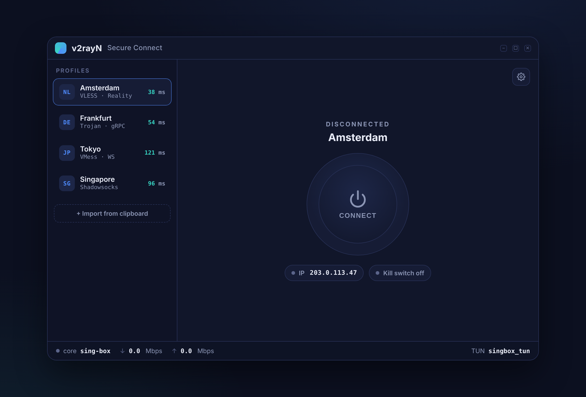
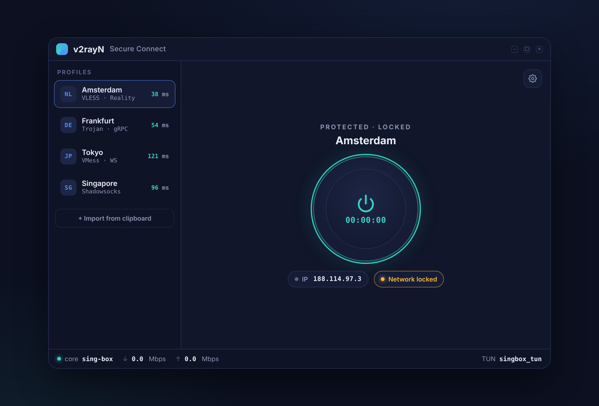
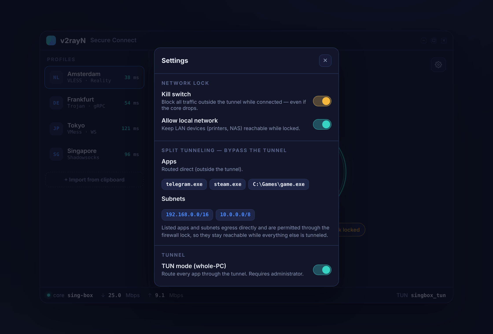
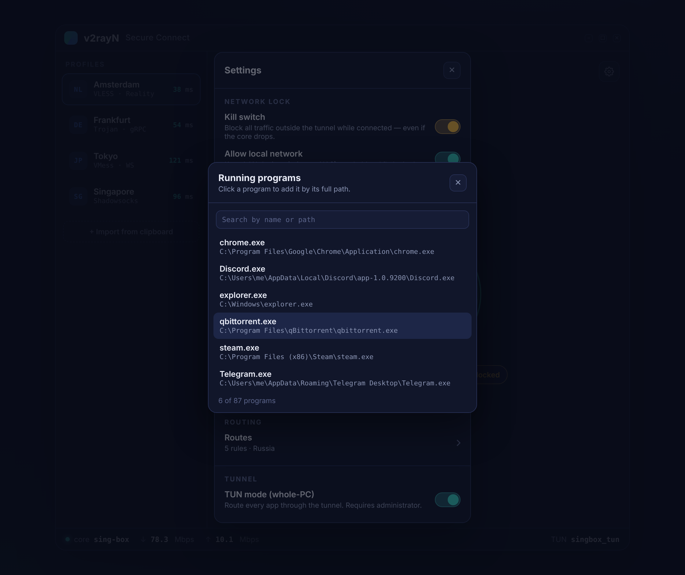
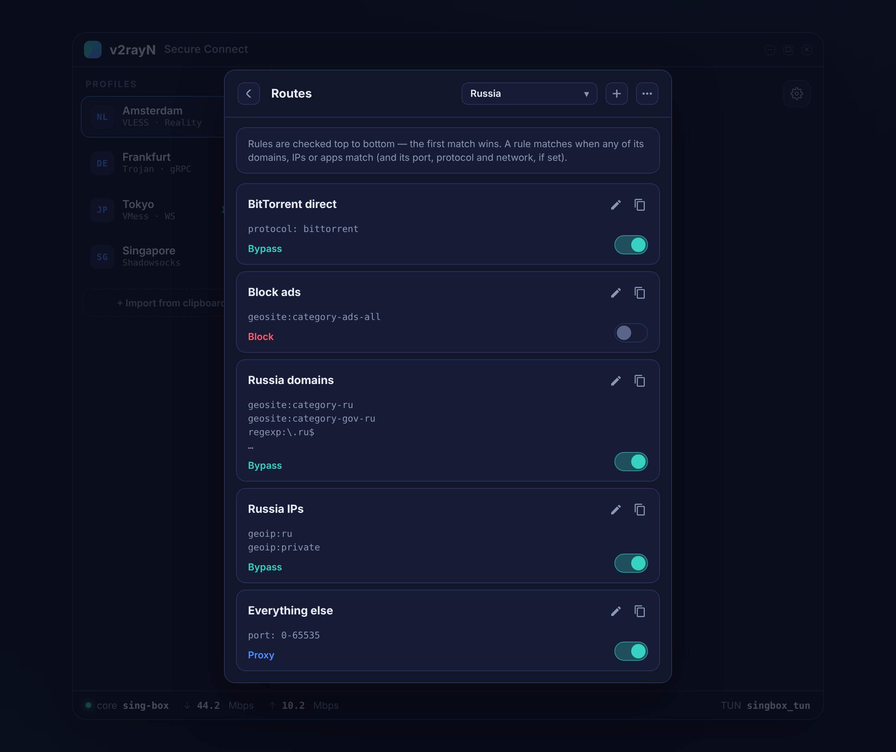
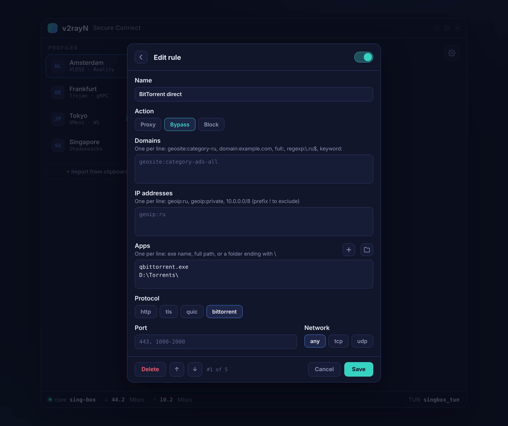

# v2rayN — Secure Connect

Форк [v2rayN](https://github.com/2dust/v2rayN) (ветка v7, Avalonia) для **Windows** с
функционалом туннелирования и контроля в духе
[WireSock Secure Connect](https://www.wiresock.net/): системный **kill switch**
(сетевой замок), **split tunneling** (раздельное туннелирование) по приложениям, папкам
и подсетям и **маршруты** в стиле NekoBox — в новом интерфейсе Secure Connect.

Цель — когда профиль работает в режиме TUN, весь трафик ПК идёт через туннель и IP
меняется целиком, а при обрыве ядра или в момент подключения/отключения ни один пакет
не может «просочиться» мимо туннеля.

> Основано на v2rayN (© 2dust), лицензия **GPL-3.0**. Это неофициальный форк для личного
> использования.

---

## Возможности поверх v2rayN

- **Главное окно Secure Connect.** Своя тёмная шапка (окно перетаскивается за неё),
  список профилей, крупная кнопка подключения с таймером сессии, внешний IP, индикатор
  замка и строка состояния со скоростью. Честные состояния: «PROTECTED» только когда
  весь ПК действительно идёт через TUN.
- **Kill switch (сетевой замок).** При подключённом TUN-профиле Windows Firewall
  переводится в режим «запрет всего исходящего по умолчанию». Наружу на физический
  интерфейс ходит только процесс ядра (`sing-box.exe`), loopback и DHCP — всё остальное
  (включая IPv6 и прямой DNS) отбрасывается. Утечки невозможны ни при падении ядра, ни
  в переходных состояниях.
- **Split tunneling — белый список.** Через туннель идут **только** перечисленные
  приложения (по имени exe, по полному пути или **целой папкой**) и подсети (CIDR),
  всё остальное — напрямую. Пустые списки — туннелируется весь ПК. Программу можно
  выбрать **из списка запущенных процессов**, папку — через стандартный диалог.
  Есть и обратный режим «Listed go direct»: перечисленное идёт мимо туннеля (и
  пропускается через замок), всё остальное — в туннель.
- **Маршруты как в NekoBox.** Карточки правил с условиями (geosite, geoip, домены, IP,
  протокол, приложения, порт, сеть) и действием **Proxy / Bypass / Block**:
  вкл/выкл, редактирование, копирование, порядок, пресеты (Russia, Iran, Default).
- **Отказоустойчивость.** Замок идемпотентен при переподключении (нет «окна утечки»),
  снимается кнопкой отключения и при выходе из приложения и автоматически
  восстанавливает сеть при старте, если прошлый запуск завершился аварийно с активным
  замком.

Весь остальной функционал v2rayN (подписки, протоколы VLESS/VMess/Trojan/Shadowsocks/
Hysteria2/TUIC/WireGuard и др., полные настройки, DNS, обновления ядер) сохранён и
доступен из меню ☰ в правом верхнем углу.

### Android

В ветке `android` — версия для Android на том же коде (Avalonia + общий
`ServiceLib`): VpnService + ядро sing-box/Xray + hev-socks5-tunnel, системный
kill switch Android, раздельное туннелирование по приложениям и подсетям,
маршруты. Сборка, установка и устройство — в [docs/ANDROID.md](docs/ANDROID.md).

---

## Интерфейс

> Иллюстрации — эталонный макет, по которому свёрстано окно приложения (Avalonia);
> расположение, цвета, шрифты и надписи совпадают.

### Главный экран — отключено



- **Шапка.** За неё окно перетаскивается, двойной клик разворачивает. Справа — меню ☰
  (все функции v2rayN, тема и язык) и кнопки «свернуть / развернуть / закрыть»
  (закрытие сворачивает в трей, как в v2rayN).
- **PROFILES.** Бейдж страны сервера (определяется по IP), протокол и пинг.
  Один клик делает профиль активным, двойной — подключается к нему, правый клик —
  Edit / Ping / Copy share link / Delete. Внизу — импорт из буфера обмена (или Ctrl+V).
- **Кнопка подключения.** CONNECT → подключение; в подключённом состоянии на ней
  идёт таймер сессии, повторное нажатие — отключение.
- **Чип IP** показывает внешний IP: реальный, когда отключено, и IP выхода туннеля,
  когда подключено.
- **Строка состояния:** ядро (точка горит, когда работает), скорость ↓/↑ в Mbps и
  «TUN singbox_tun» — клик включает/выключает режим TUN.

### Подключено · сетевой замок активен



| Надпись над кнопкой | Что значит |
|---|---|
| `DISCONNECTED` | ядро остановлено, трафик идёт как обычно |
| `CONNECTING…` / `DISCONNECTING…` | идёт подключение или отключение (синяя дуга) |
| `PROTECTED` | режим TUN: весь трафик ПК идёт через туннель |
| `PROTECTED · LOCKED` | то же + kill switch держит сетевой замок |
| `SPLIT TUNNEL` / `SPLIT TUNNEL · LOCKED` | TUN с белым списком: через туннель идут только перечисленные приложения и подсети |
| `CONNECTED · PROXY ONLY` | без TUN — работает только системный прокси (обычно программа запущена без прав администратора) |

Чип замка: **Network locked** (замок активен) · **Kill switch armed** (включён,
сработает при подключении) · **Kill switch needs TUN** (включён, но без TUN замок не
ставится) · **Kill switch off**.

### Настройки (шестерёнка)



- **NETWORK LOCK** — kill switch и «Allow local network» (принтеры, NAS, SSH в LAN
  остаются доступны при замке).
- **SPLIT TUNNELING** — режим и списки:
  - **Only listed via tunnel** (по умолчанию, белый список) — через туннель идут только
    перечисленные приложения и подсети, остальное напрямую; пустые списки — весь ПК
    через туннель;
  - **Listed go direct** — наоборот: перечисленное идёт мимо туннеля, остальное в туннель.

  У «Apps» две кнопки: **+** — выбрать запущенную программу, **папка** — добавить
  целую папку. Можно и вписать вручную (Enter); × удаляет запись.
- **ROUTING** — переход к маршрутам (число правил и текущий набор).
- **TUNNEL** — режим TUN на весь ПК (нужны права администратора; если их нет,
  приложение перезапустится от администратора через запрос UAC).

Переключатели применяются сразу, списки — при закрытии панели. Полные настройки
v2rayN (включая прежнюю вкладку **Kill Switch**) остаются в меню ☰ → Settings.

### Выбор запущенной программы



Поиск по имени или пути; клик добавляет программу **по полному пути** (так её точно
пропустит и маршрутизация, и сетевой замок). Видны и программы, запущенные от
администратора.

### Маршруты



- Правила проверяются **сверху вниз — срабатывает первое подходящее**. Новые правила
  добавляются наверх (наборы обычно заканчиваются правилом «всё остальное»).
- Правило срабатывает, если подходит **любой** из его доменов, IP или приложений
  (и при этом порт, протокол и сеть, если они заданы). Для условия «и то, и другое»
  сделайте два правила.
- Вверху — выбор набора правил (наборы v2rayN), **+** — новое правило, меню ⋯ —
  пресеты **Russia / Iran / Default** и полный редактор маршрутизации v2rayN.
- Правила хранятся в стандартных наборах маршрутизации v2rayN, поэтому работают и с
  sing-box, и с Xray. Изменения сохраняются и сразу применяются к активному
  подключению.
- При белом списке split tunneling маршруты применяются к трафику перечисленных
  приложений и подсетей — всё остальное уже ушло напрямую.

### Редактор правила



| Поле | Формат (по одному на строку) |
|---|---|
| Domains | `geosite:category-ru`, `domain:example.com` (домен и поддомены), `full:example.com` (точно), `regexp:\.ru$`, `keyword:google` |
| IP addresses | `geoip:ru`, `geoip:private`, `10.0.0.0/8`, `1.2.3.4`; `!` в начале — исключить |
| Apps | `qbittorrent.exe`, `C:\Program Files\App\app.exe`, папка `D:\Torrents\` |
| Protocol | http, tls, quic, bittorrent (нужен включённый sniffing) |
| Port / Network | `443, 1000-2000` / any, tcp, udp |

Внизу — удаление (с подтверждением) и перемещение правила вверх/вниз.

---

## Как работает kill switch

Модель «запрет по умолчанию + белый список» (как у WireGuard):

1. Текущий `DefaultOutboundAction` каждого профиля фаервола сохраняется в файл
   состояния (для восстановления после сбоя).
2. Добавляется группа Outbound/Allow-правил `v2rayN-KillSwitch`:
   - процесс ядра (`sing-box.exe`) — единственный прямой выход в сеть;
   - loopback (`127.0.0.1` / `::1`) — локальные прокси-порты и связь UI↔ядро;
   - DHCP (UDP 67/68) — чтобы адаптер сохранял аренду;
   - опционально: LAN; в режиме «Listed go direct» — перечисленные приложения и
     подсети.
3. `DefaultOutboundAction` переключается в `Block` на всех профилях.

Замок ставится после успешного подключения в режиме TUN и **не снимается** при
переподключении или смене профиля. Снимается он кнопкой отключения, выходом из
программы, а также при переподключении, если kill switch выключен в настройках или
сессия больше не в режиме TUN.

В режиме белого списка исключений в замке нет: перечисленные приложения обязаны идти
через туннель, а остальной трафик и так выходит через ядро. Если туннель упал,
блокируется всё — до переподключения или отключения.

Требуются права администратора — которые режим TUN и так требует.

**Аварийная ручная разблокировка** (PowerShell от админа), если приложение было
закрыто некорректно:

```powershell
Set-NetFirewallProfile -All -DefaultOutboundAction Allow
Remove-NetFirewallRule -Group 'v2rayN-KillSwitch' -ErrorAction SilentlyContinue
```

### Как сопоставляются приложения в split tunneling

В режиме белого списка sing-box одним логическим правилом (после перехвата DNS)
отправляет напрямую всё, что пришло в TUN и не подходит ни под одну запись;
перечисленный трафик дальше идёт по маршрутам. В режиме «Listed go direct» записи
сразу отправляются напрямую, а замок их пропускает.

| Запись | Маршрутизация (sing-box) | Сетевой замок (только «Listed go direct») |
|---|---|---|
| `telegram.exe` | по имени процесса (`process_name`) | только если программа была запущена в момент подключения (путь берётся у процесса) |
| `C:\…\app.exe` | по полному пути (`process_path`) | разрешается этот exe |
| `D:\Games\` | все программы в папке и подпапках (`process_path_regex`, без учёта регистра) | разрешаются все `.exe` в папке на момент подключения (до 150) |

Программы, добавленные в папку позже, маршрутизация пропускает сразу, а замок — после
переподключения.

---

## Сборка

Требуется Windows, **.NET 10 SDK** и Git.

```powershell
git clone --recurse-submodules -b secure-connect https://github.com/lKAYNONl/v2rayN_Sconnect.git
cd v2rayN_Sconnect\v2rayN
dotnet publish v2rayN.Desktop -c Release -r win-x64 --self-contained true -o publish
Start-Process .\publish\v2rayN.exe -Verb RunAs
```

- Если репозиторий склонирован без `--recurse-submodules` (ошибки про `GlobalHotKeys`):
  `git submodule update --init --recursive`.
- Ошибка MSB3027 «файл занят» — закройте запущенную программу:
  `Stop-Process -Name v2rayN -Force`.
- Публикуйте в ту же папку `publish`: настройки и профили лежат рядом с exe.
- При первом запуске новой версии включается показ скорости, а окно открывается в
  размере макета (940×620); дальше размер запоминается.

Запускать приложение **от имени администратора** (нужно для TUN и фаервола).

---

## Использование

1. Запустите программу от имени администратора.
2. Импортируйте профиль: «+ Import from clipboard», Ctrl+V или ☰ → подписки.
3. Кликните по профилю — он станет активным.
4. Шестерёнка → **Settings**: включите **Kill switch** и **TUN mode**. Если через
   туннель должны идти только некоторые программы — добавьте их (или папки/подсети)
   в split tunneling (режим **Only listed via tunnel**); пустые списки — туннелируется
   весь ПК.
5. По желанию: **Routes** → меню ⋯ → **Preset: Russia** (российские сайты и IP мимо
   туннеля) или свои правила.
6. Нажмите **CONNECT**. Ожидаемо: `PROTECTED · LOCKED` (или `SPLIT TUNNEL · LOCKED`,
   если белый список не пуст) и жёлтый чип «Network locked».
7. Проверка замка:
   ```powershell
   Get-NetFirewallProfile -All | Format-Table Name, DefaultOutboundAction   # все Block
   Get-NetFirewallRule -Group 'v2rayN-KillSwitch'                           # правила на месте
   ```

Повторное нажатие на кнопку — отключение: ядро останавливается, замок снимается,
системный прокси очищается.

---

## Статус

- [x] Kill switch (Windows Firewall) + интеграция в жизненный цикл ядра
- [x] Split tunneling: белый список (и режим обхода); приложения, папки, подсети;
  выбор из запущенных программ
- [x] Главное окно Secure Connect: своя шапка, кнопка с таймером, IP, замок, скорость
- [x] Явное отключение (Disconnect) со снятием замка
- [x] Панель настроек в окне (kill switch, LAN, split tunneling, TUN)
- [x] Маршруты в стиле NekoBox: карточки, редактор, пресеты
- [ ] Нативный WFP-бэкенд замка (упрочнение против чужих Allow-правил)
- [ ] Локализация нового интерфейса (сейчас надписи на английском)

---

## Лицензия и благодарности

Проект наследует лицензию **GPL-3.0** от оригинального
[v2rayN](https://github.com/2dust/v2rayN) (© 2dust). Ядра —
[sing-box](https://github.com/SagerNet/sing-box) и [Xray-core](https://github.com/XTLS/Xray-core).
Идея интерфейса — [WireSock Secure Connect](https://www.wiresock.net/), экран маршрутов —
по мотивам [NekoBox](https://github.com/MatsuriDayo/NekoBoxForAndroid).

Шрифты: [Manrope](https://github.com/sharanda/manrope) (© The Manrope Project Authors) и
[IBM Plex Mono](https://github.com/IBM/plex) (© IBM Corp., Reserved Font Name «Plex») —
SIL Open Font License 1.1, тексты лицензий лежат рядом со шрифтами в
`v2rayN/v2rayN.Desktop/Assets/Fonts`.

Приложение предназначено для личного использования; ответственность за соблюдение
применимого законодательства несёт пользователь.
